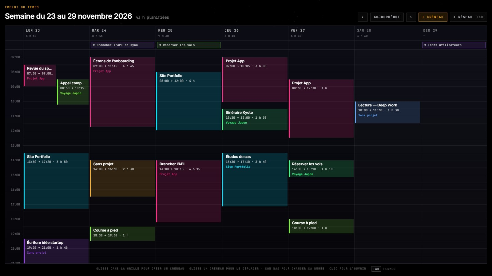

# Synapse

**Ton réseau personnel, en 3D.** Projets, tâches, notes et créneaux, tous reliés : tu voles au milieu de tes idées, et tu retrouves tout par les liens. Sur ton PC et sur ton téléphone, avec ton compte : ce que tu fais sur l’un apparaît aussitôt sur l’autre.

## Télécharger

### Sur ton téléphone Android

1. Depuis le téléphone, ouvre **[Synapse.apk](https://github.com/AwayFN/Synapse/releases/latest/download/Synapse.apk)** (page des versions : [Releases](https://github.com/AwayFN/Synapse/releases/latest)).
2. Ouvre le fichier téléchargé. Android demande d’autoriser l’installation d’applications « inconnues » : autorise ton navigateur, puis **Installer**.
3. Ouvre **Synapse** (l’icône du neurone néon) : **crée ton compte**, ou connecte-toi si tu en as déjà un.

### Sur ton PC (Windows)

1. Installe **Node.js** (gratuit, une seule fois) : [nodejs.org](https://nodejs.org/fr/download), version **LTS**.
2. **[Télécharge Synapse](https://github.com/AwayFN/Synapse/archive/refs/heads/main.zip)**, puis clic droit sur le fichier téléchargé → **Extraire tout**.
3. Ouvre le dossier et double-clique sur **Lancer Synapse**.
4. **Crée ton compte** (prénom, e-mail, mot de passe), ou connecte-toi avec celui de ton téléphone.

Si Windows demande « Voulez-vous exécuter ce fichier ? », clique **Exécuter**. Si le fichier est bloqué : clic droit sur le `.zip` → **Propriétés** → coche **Débloquer** → OK, puis extrais-le de nouveau.

## Ton compte, sur tous tes appareils

- La **première chose** à faire en ouvrant Synapse : **créer ton compte**. Ensuite, c’est bon : tu restes connecté sur cet appareil.
- **Se déconnecter** (ton prénom en haut à droite → Session) : il faudra se reconnecter avec ton e-mail et ton mot de passe.
- Le même compte sur ton PC et ton téléphone : **tout se synchronise en direct**. Une note écrite sur le téléphone apparaît sur le PC en une seconde, sans rien relancer.
- Le réseau change (Wi-Fi ↔ câble ↔ 4G/5G), une coupure, une mise en veille : la connexion repart toute seule, et ce que tu as modifié pendant la coupure part dès qu’elle revient.

## Ce que fait Synapse

- **Le réseau en 3D** : chaque projet, tâche, note et créneau est une constellation néon. Tu voles au milieu (molette, clic droit, ZQSD ; au doigt sur téléphone), tu cliques pour ouvrir.
- **Écrire en grand** : une note, et aussi la description d’une tâche, d’un projet ou d’un créneau, s’ouvrent sur presque tout l’écran, comme le Bloc-notes. **A− / A+** en bas pour la taille du texte.
- **Des tags sur tout** : projets, tâches, notes, créneaux. Un clic sur un tag allume ce qui le porte ; `#tag` dans `Ctrl+K` cherche tout ce qui le porte.
- **Les notes** : une vue avec toutes tes notes, **par projet** ou **indépendantes** (comme les tâches indépendantes), filtrables par tag.
- **L’emploi du temps** : ta semaine en grille. Glisse pour créer un créneau, pour le déplacer, pour changer sa durée.
- **Les tâches** : un tableau à faire / en cours / fait.
- **Tout se relie** : « + Lier à… » relie n’importe quoi à n’importe quoi. `Ctrl+K` pour créer ou chercher en une phrase : `tâche Appeler Léa @Projet_App demain 14h #urgent`.
- **Échap** (ou le bouton retour du téléphone) ferme ce qui est ouvert, partout.

**L’emploi du temps**, une semaine en grille (touche `Tab`) :

**Une note**, sur presque tout l’écran (`Ctrl+N`) :

## Le Synapse central

Tous les comptes et tous les cerveaux vivent sur **un seul serveur Synapse, le Synapse central**. Les applications (téléphones Android, PC Windows) s’y connectent toutes : c’est ce qui permet de retrouver son compte partout, et à l’admin de voir tout le monde.

- Le Synapse central tourne sur le **PC du créateur** (le premier PC où Synapse a été installé, avec ses données). Ce PC doit rester **allumé**, avec **l’accès Internet ouvert** (Espace admin → Serveur).
- Son adresse Internet gratuite change à chaque redémarrage de Synapse : il la **publie tout seul sur ce dépôt GitHub** (branche `synapse-adresse`, fichier `adresse.json`). Les applications la retrouvent toutes seules, **sans se déconnecter**.
- Sur un autre PC, « Lancer Synapse » se connecte au Synapse central (rien à compiler). Pour faire de ce PC un serveur indépendant : `Lancer Synapse.cmd --serveur` (revenir : `--client`).
- Pour un Synapse toujours en ligne, même PC éteint : voir [METTRE-EN-LIGNE.txt](METTRE-EN-LIGNE.txt) (adresse fixe, hébergeur, Docker).

## Les comptes et les admins

- Chacun **crée son compte** en ouvrant l’application (inscriptions ouvertes ; l’admin peut passer « sur invitation » ou « fermées »).
- Le créateur de Synapse est admin. Dans l’**espace admin**, il voit **tous les comptes**, leurs **appareils** (application Android, application Windows, navigateur), qui est **en ligne** et où, les statistiques, les retours et les erreurs. Il peut **nommer d’autres admins** (mêmes droits, sauf sur son compte).
- L’espace admin montre des chiffres et des métadonnées, **jamais le contenu des cerveaux**.

## Partager ton cerveau

Bouton **Partager**, en haut à droite : pour chaque personne, **Peut modifier** ou **Peut seulement regarder**, puis envoie le lien. **Une seule personne écrit à la fois dans une même note** : les autres la voient en lecture seule, avec son prénom. Les éléments marqués 🔒 privés ne sont jamais montrés.

## Tes données

- Sur le Synapse central : `%APPDATA%\Synapse` (un dossier par cerveau, une sauvegarde par jour pendant 14 jours).
- Export à tout moment : `Ctrl+K`, puis « Exporter mes données » (sur téléphone : dans Téléchargements).

## L’application Android (pour le créateur)

Le code est dans [`android/`](android). GitHub la construit tout seul : chaque étiquette `v…` (par exemple `v6.0.0`) publie une nouvelle version sur la page [Releases](https://github.com/AwayFN/Synapse/releases), avec le fichier `Synapse.apk`. L’application vérifie une fois par jour s’il existe une version plus récente.

Pour que les mises à jour s’installent par-dessus l’ancienne version, ajoute une fois une clé de signature permanente dans les secrets du dépôt (Settings → Secrets and variables → Actions) : `SYNAPSE_KEYSTORE_BASE64` (fichier `.jks` en base64, alias `synapse`) et `SYNAPSE_KEYSTORE_PASSWORD`. Sans elle, chaque version a sa propre clé : pour mettre à jour, désinstaller puis réinstaller (le compte et les données restent sur le serveur).

Le mode d’emploi complet est dans [LISEZ-MOI.txt](LISEZ-MOI.txt), et dans l’application (touche `?`).
