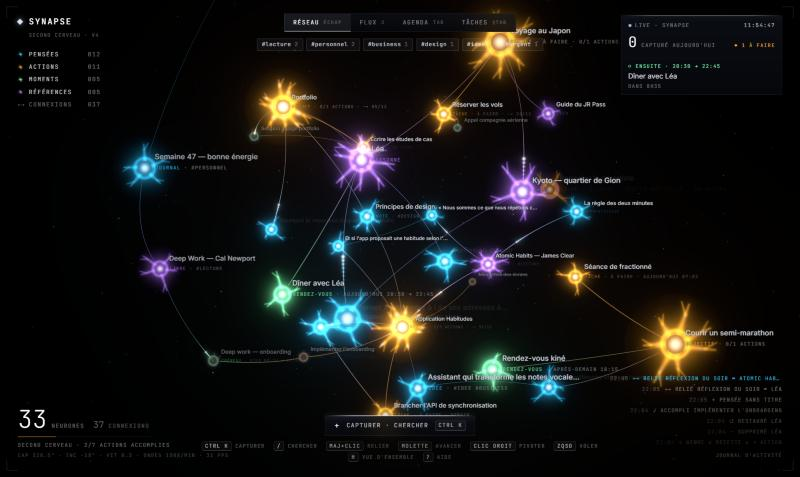

# Synapse

**Ton second cerveau, en 3D.** Capture une pensée en une seconde, relie-la aux autres, et retrouve-la en volant dans un réseau de neurones néon. Seul, ou à plusieurs.

## Télécharger et lancer (Windows)

1. Installe **Node.js** (gratuit, une seule fois) : [nodejs.org](https://nodejs.org/fr/download), version **LTS**.
2. Télécharge Synapse : **[Synapse.zip](https://github.com/AwayFN/Synapse/archive/refs/heads/main.zip)**, puis clic droit sur le fichier → **Extraire tout**.
3. Ouvre le dossier et double-clique sur **Lancer Synapse**.

Synapse s'ouvre dans sa propre fenêtre. Ton cerveau est enregistré sur ton ordinateur, rien n'est envoyé ailleurs.

> Mac ou Linux : avec Node.js installé, lance `node app/scripts/synapse.mjs` depuis le dossier de Synapse.

## Ce que fait Synapse

- **Capturer sans effort** : `Ctrl+K`, tu écris, `Entrée`. Une phrase brute devient une pensée ; tu peux y glisser un moment (« demain 14h »), un #tag, un lien vers une autre pensée (`[[Léa]]`).
- **Retrouver par les liens** : clique un neurone, ses connexions s'allument ; `Maj+clic` pour relier deux pensées. Synapse te suggère aussi des connexions possibles.
- **Un langage visuel qui a du sens** : chaque pensée est un neurone néon. Sa couleur dit sa nature (cyan pensées, ambre actions, menthe moments, violet références), ses branches ses liens, son éclat sa vitalité. Ce qui est terminé s'éteint, ce qui est en retard grésille, et des impulsions voyagent d'un neurone à l'autre.
- **Quatre vues** : le réseau 3D, le flux, l'agenda, les tâches.

## Partager ton cerveau

Bouton **Partager**, en haut à droite :

1. Ouvre un accès : **même Wi-Fi** (quelqu'un chez toi), ou **depuis n'importe où** (par Internet, grâce à une adresse sécurisée gratuite de Cloudflare ; Synapse télécharge l'outil `cloudflared` une fois, seulement si tu coches la case d'accord).
2. Crée une invitation : rôle (lecture, contribution, édition) et zone (tout, ou certains #tags).
3. Envoie le lien. La personne n'a **rien à installer** : elle ouvre le lien dans son navigateur, entre avec son prénom ou crée un compte, et vous voyez vos pensées en direct.

Tes neurones marqués 🔒 privés ne sont jamais montrés. Ton ordinateur doit rester allumé pendant le partage, et l'adresse Internet gratuite change à chaque redémarrage de Synapse.

Tu peux aussi inviter des amis à **créer leur compte sur ton Synapse** : ils ont alors leur propre cerveau, sans rien installer. Tu les retrouves dans ton **espace créateur** (des chiffres seulement, jamais le contenu de leurs cerveaux).

## Tes données

- Tout est dans `%APPDATA%\Synapse` : un dossier par cerveau, avec une sauvegarde par jour (14 jours).
- Export à tout moment : `Ctrl+K`, puis `>`, puis « Exporter mes données ».

## Mettre Synapse en ligne pour tout le monde

Pour un Synapse toujours accessible, sans ton ordinateur : voir [METTRE-EN-LIGNE.txt](METTRE-EN-LIGNE.txt) (adresse fixe, hébergeur, Docker).

## Pour l'instant

- Le lanceur est fait pour Windows.
- Synapse s'utilise sur ordinateur : la navigation 3D n'est pas encore adaptée au téléphone.

Le mode d'emploi complet est dans [LISEZ-MOI.txt](LISEZ-MOI.txt), et dans l'application (touche `?`).
