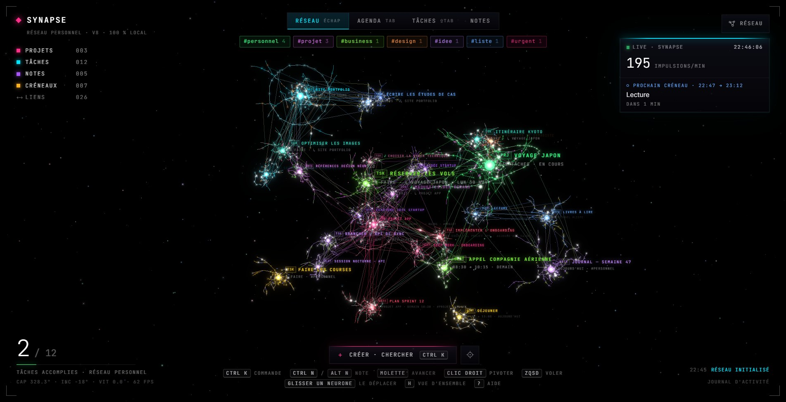
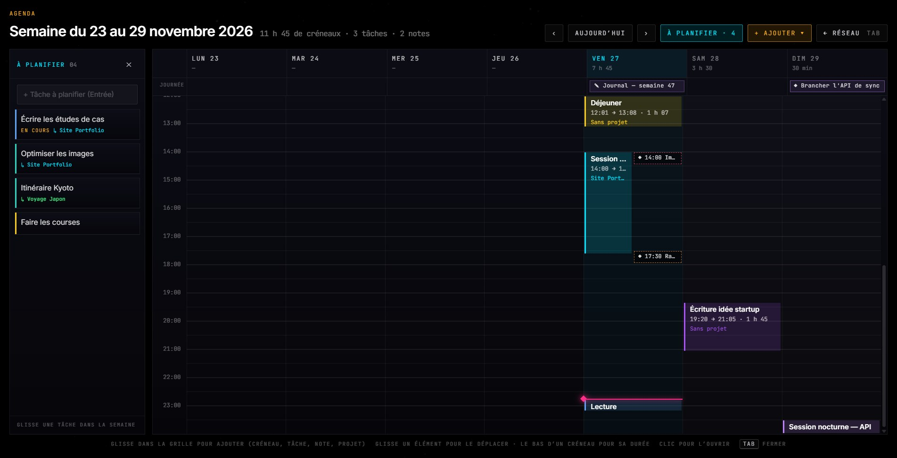

# Synapse

**Ton réseau personnel, en 3D. 100 % local.** Projets, tâches, notes et créneaux, tous reliés : tu voles au milieu de tes idées, et tu retrouves tout par les liens. Pas de compte, pas d’inscription, pas de connexion : Synapse marche sans Internet, et tes données restent sur ton appareil.

## Télécharger

### Sur ton PC (Windows)

1. Télécharge **[Synapse-Setup.exe](https://github.com/AwayFN/Synapse/releases/latest/download/Synapse-Setup.exe)** (page des versions : [Releases](https://github.com/AwayFN/Synapse/releases/latest)).
2. Ouvre le fichier téléchargé : Synapse s’installe tout seul en quelques secondes, puis s’ouvre.
3. Une icône **Synapse** est maintenant sur ton bureau (et dans le menu Démarrer) : **un double-clic ouvre Synapse**. Le fichier d’installation, lui, s’efface tout seul une fois Synapse installé : il ne reste qu’une seule icône Synapse.

Si Windows affiche « Windows a protégé votre ordinateur » : clique **Informations complémentaires**, puis **Exécuter quand même** (Synapse n’est pas signé par un éditeur payant, c’est normal).

Tu avais déjà Synapse (une version d’avant, avec « Lancer Synapse ») sur ce PC, et c’est lui qui gardait ton réseau ? Au premier lancement, ton réseau est **repris automatiquement**, avec la place de chaque neurone. Sur un autre appareil : dans l’ancienne version, `Ctrl K` → **Exporter mes données**, puis dans la nouvelle, **Importer des données**.

### Sur ton téléphone (Android)

1. Depuis le téléphone, ouvre **[Synapse.apk](https://github.com/AwayFN/Synapse/releases/latest/download/Synapse.apk)**.
2. Ouvre le fichier téléchargé. Android demande d’autoriser l’installation d’applications « inconnues » : autorise ton navigateur, puis **Installer**.
3. Une icône **Synapse** apparaît sur l’écran d’accueil : **un appui l’ouvre**.

Une ancienne version de Synapse est déjà sur le téléphone ? Android refusera peut-être d’installer par-dessus : dans l’ancienne, fais d’abord `Ctrl K` (bouton « Créer · chercher ») → **Exporter mes données** (le fichier va dans Téléchargements), désinstalle-la, installe la nouvelle, puis **Importer** ce fichier.

## 100 % local

- **Aucun compte, aucune inscription, aucune connexion.** Synapse n’envoie rien nulle part : l’application Android n’a même pas la permission d’accéder à Internet, et l’application Windows refuse toute connexion.
- **Tes données restent sur ton appareil :**
  - sur Windows, dans `%APPDATA%\Synapse\synapse-donnees.json`, avec **une sauvegarde par jour** (gardée 14 jours) dans `%APPDATA%\Synapse\sauvegardes` ;
  - sur Android, dans le téléphone, avec **une sauvegarde automatique** dans `Documents/Synapse` (une par jour de la semaine) : elle reste même si tu désinstalles Synapse.
- **La version Windows et la version Android sont indépendantes** : rien ne se synchronise. Pour copier ton réseau d’un appareil à l’autre (ou le garder ailleurs) : `Ctrl K` → **Exporter mes données** (un fichier `.json`), puis **Importer des données** de l’autre côté.

## Ce que fait Synapse

- **Le réseau en 3D** : chaque projet, tâche, note et créneau est une constellation néon. Tu voles au milieu (molette, clic droit, ZQSD ; au doigt sur téléphone), tu cliques pour ouvrir.
- **Place tes neurones toi-même, où tu veux** : glisse un neurone (au doigt : appui long, puis glisse) ; pendant que tu le tiens, la molette (au doigt : un deuxième doigt, et pincer) l’éloigne ou le rapproche, aussi loin que tu veux : aucune zone, aucune limite. Il reste exactement où tu le poses, même après avoir fermé Synapse (◆ après son nom). « Libérer », dans sa fiche, lui rend sa place automatique.
- **La distance entre les neurones**, sans limite artificielle : bouton **Réseau** en haut à droite, un curseur pour les neurones **liés** et un pour les **non liés** (de 5 % à 5 000 %), ou tape directement la valeur que tu veux, de 1 % à 100 000 %. Le réseau prend aussitôt sa nouvelle taille.
- **L’agenda** : ta semaine en grille, ton espace d’organisation. Tu y ajoutes des **créneaux**, des **tâches**, des **notes** et des **projets** (leur échéance) : glisse dans la grille, puis choisis ce que c’est. Glisse un élément pour le déplacer. **À planifier** : tes tâches sans date, à glisser dans la semaine. Sur le téléphone : un jour à la fois, et tu glisses le doigt pour changer de jour.
- **Écrire en grand** : une note, et aussi la description d’une tâche, d’un projet ou d’un créneau, s’ouvrent sur presque tout l’écran, comme le Bloc-notes. **A− / A+** en bas pour la taille du texte.
- **Des tags sur tout**, sur PC comme sur téléphone : projets, tâches, notes, créneaux. Un appui sur un tag allume ce qui le porte ; `#tag` dans `Ctrl K` cherche tout ce qui le porte.
- **Les notes** : une vue avec toutes tes notes, **par projet** ou **indépendantes**, filtrables par tag.
- **Les tâches** : un tableau à faire / en cours / fait. Sur le téléphone : une colonne à la fois (glisse pour passer à la suivante), la liste défile au doigt, et un appui long sur une carte la déplace.
- **Sur le téléphone**, une barre en bas de l’écran (**Réseau · Agenda · Tâches · Notes**) dans toutes les vues ; les fiches montent du bas de l’écran.
- **Tout se relie** : « + Lier à… » relie n’importe quoi à n’importe quoi. `Ctrl K` pour créer ou chercher en une phrase : `tâche Appeler Léa @Projet_App demain 14h #urgent`.
- **Revenir aux neurones** : le petit bouton rond ◎ à côté de « Créer · chercher » te ramène devant ton réseau presque instantanément. (Le double-clic dans le vide fait la vue d’ensemble en douceur.)
- **Échap** (ou le bouton retour du téléphone) ferme ce qui est ouvert, partout.

**L’agenda**, ta semaine en grille (touche `Tab`) :

**Une note**, sur presque tout l’écran (`Ctrl+N`) :

## Pour le créateur

Le code :

- [`app/`](app) : l’application elle-même (React, three.js), la même pour Windows et Android ;
- [`desktop/`](desktop) : la version Windows (Electron) et son installateur ;
- [`android/`](android) : la version Android (une vue web qui contient `app/dist`).

GitHub construit tout seul les deux versions (voir [`.github/workflows/synapse.yml`](.github/workflows/synapse.yml)) : chaque étiquette `v…` (par exemple `v8.1.0`) publie une nouvelle version sur la page [Releases](https://github.com/AwayFN/Synapse/releases), avec `Synapse-Setup.exe` et `Synapse.apk`. À chaque modification, une construction d’essai lance aussi l’application Android sur un téléphone simulé.

Construire à la main (Node.js 22) : dans `app/`, `npm ci` puis `npm run build` ; dans `desktop/`, `npm ci` puis `npm run dist` (l’installateur arrive dans `desktop/release/`).

Pour que les mises à jour Android s’installent par-dessus l’ancienne version (sans désinstaller), ajoute une fois une clé de signature permanente dans les secrets du dépôt (Settings → Secrets and variables → Actions) : `SYNAPSE_KEYSTORE_BASE64` (fichier `.jks` en base64, alias `synapse`) et `SYNAPSE_KEYSTORE_PASSWORD`.

Le mode d’emploi complet est dans [LISEZ-MOI.txt](LISEZ-MOI.txt), et dans l’application (touche `?`).
