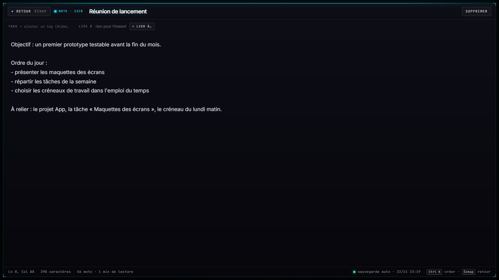

# Synapse

**Ton réseau personnel, en 3D.** Projets, tâches, notes et créneaux, tous reliés : tu voles au milieu de tes idées, et tu retrouves tout par les liens. Seul, ou à plusieurs.

## Télécharger et lancer (Windows)

1. Installe **Node.js** (gratuit, une seule fois) : [nodejs.org](https://nodejs.org/fr/download), version **LTS**.
2. **[Télécharge Synapse](https://github.com/AwayFN/Synapse/archive/refs/heads/main.zip)**, puis clic droit sur le fichier téléchargé → **Extraire tout**.
3. Ouvre le dossier et double-clique sur **Lancer Synapse**.
4. Premier lancement : **crée ton compte** (prénom, e-mail, mot de passe).

Si Windows demande « Voulez-vous exécuter ce fichier ? », clique **Exécuter**. Si le fichier est bloqué : clic droit sur le `.zip` → **Propriétés** → coche **Débloquer** → OK, puis extrais-le de nouveau.

> Tu veux juste **rejoindre le Synapse d’un ami** ? N’installe rien : ouvre le lien qu’il t’envoie, sur ton ordinateur ou ton téléphone.

## Ce que fait Synapse

- **Le réseau en 3D** : chaque projet, tâche, note et créneau est une constellation néon. Tu voles au milieu (molette, clic droit, ZQSD), tu cliques pour ouvrir.
- **Les notes en grand** : une note s’ouvre sur presque tout l’écran, comme le Bloc-notes, avec en bas la ligne, la colonne, les caractères et les mots.
- **L’emploi du temps** : ta semaine en grille, les heures à gauche. Glisse dans la grille pour créer un créneau, glisse-le pour le déplacer, tire son bas pour changer sa durée. Chaque créneau peut appartenir à un projet (« Sans projet » sinon), et la fiche du projet montre le temps qui lui est consacré.
- **Les tâches** : un tableau à faire / en cours / fait.
- **Tout se relie** : « + Lier à… » dans chaque fiche et en haut de chaque note relie une note, une tâche, un projet ou un créneau à n’importe quel autre.
- `Ctrl+K` pour créer ou chercher en une phrase : `tâche Appeler Léa @Projet_App demain 14h`, `créneau 12h01-17h38 Deep work @App`.

**L’emploi du temps**, une semaine en grille (touche `Tab`) :

**Une note**, sur presque tout l’écran (`Ctrl+N`) :

## Partager ton cerveau

Bouton **Partager**, en haut à droite :

1. Pour chaque personne, choisis ce qu’elle peut faire : **Peut modifier** ou **Peut seulement regarder**.
2. **Créer le lien d’invitation** : Synapse ouvre une adresse Internet sécurisée et gratuite (Cloudflare ; il télécharge l’outil `cloudflared` une fois, seulement avec ton accord). Pour quelqu’un chez toi : **même Wi-Fi**.
3. Envoie le lien. La personne n’a **rien à installer** : elle l’ouvre dans son navigateur.

**Une seule personne écrit à la fois dans une même note** : les autres la voient en lecture seule, avec son prénom, jusqu’à ce qu’elle ait fini. Les éléments marqués 🔒 privés ne sont jamais montrés. Ton ordinateur doit rester allumé ; l’adresse Internet gratuite change quand Synapse redémarre (bouton **Lien** à côté de chaque personne pour lui renvoyer le sien : elle revient à sa place).

## Les comptes et les admins

- À l’installation, chacun **crée son compte** : c’est un compte normal, **sans espace admin**.
- Le créateur de Synapse est admin. Dans l’**espace admin**, il peut **nommer d’autres admins** : ils ont exactement les mêmes droits que lui (sauf sur son compte).
- L’espace admin montre les personnes qui ont un compte sur **ce** Synapse (celles qui ont ouvert ton lien). Quelqu’un qui installe Synapse chez lui a son propre Synapse, séparé.

## Sur ton téléphone

Ton prénom en haut à droite → **Sur ton téléphone** → vise le QR code avec l’appareil photo : tu es connecté, tout se synchronise en direct. Au doigt : un doigt tourne autour du réseau, pincer avance ou recule, deux doigts déplacent, toucher ouvre.

## Tes données

- Tout est dans `%APPDATA%\Synapse` : un dossier par cerveau, avec une sauvegarde par jour (14 jours).
- Export à tout moment : `Ctrl+K`, puis « Exporter mes données ».

## Mettre Synapse en ligne pour tout le monde

Pour un Synapse toujours accessible, sans ton ordinateur : voir [METTRE-EN-LIGNE.txt](METTRE-EN-LIGNE.txt) (adresse fixe, hébergeur, Docker).

Le mode d’emploi complet est dans [LISEZ-MOI.txt](LISEZ-MOI.txt), et dans l’application (touche `?`).
